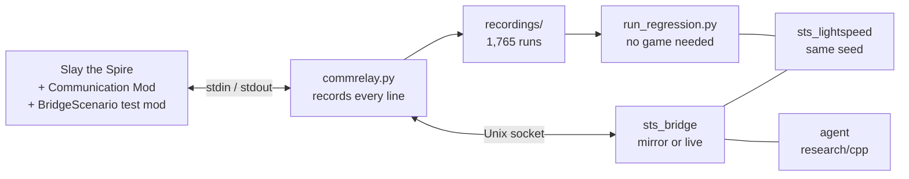

# Real-game bridge

Connects a Slay the Spire agent to the real game, to find out whether the simulator it learned in plays like the game. That led to 219 fixes to [sts_lightspeed](https://github.com/gamerpuppy/sts_lightspeed): 169 differences the game showed, and 50 found by reading the game's code. The fixed simulator is at [latioswang/sts_lightspeed](https://github.com/latioswang/sts_lightspeed).

- **Mirror mode** starts the same seed in the game and in the simulator. The agent picks each move in the simulator, the bridge sends it to the game, and the two states are compared after every move. The first difference stops the run: it is a simulator bug or a bridge bug.
- **Live mode** lets the agent play the real game. Each decision rebuilds a simulator state from what the game shows, so a simulator difference can't derail the run, and the agent never sees anything a player couldn't.
- **The replay test** plays every recorded run back through mirror mode with no game running. The game is only needed for new runs.

**[How to use it](USAGE.md)** · [Every fix](reports/simulator_fixes.md) · [Progress log](PROGRESS.md) · [The fixed simulator](https://github.com/latioswang/sts_lightspeed)

## At a glance

As of 2026-11-09, on the fork's `master` (`c1cf847`):

| Measure | Result |
|---|---|
| Runs recorded on the real game, 2026-11-02 to 2026-11-07 | 1,765, all four characters, every ascension from 0 to 20. They are [in git](#the-recordings-in-git), 41 MB |
| Recorded moves replayed with the whole state compared | 754,533 |
| Replay result | 1,466 reach the end with no difference. 251 stop early without a verdict, mostly at a Discovery the recording can't check (161), a move the bridge no longer sends (39), or a difference in a run whose test scenario had to be rebuilt (34). 48 are known failures, each with its reason in [`regression_baseline.tsv`](regression_baseline.tsv) |
| Whole runs with no difference, on distinct seeds | Ironclad 422, Silent 248, Defect 249, Watcher 248 |
| Act 4 | Seeds 1000 and 1004 replay through the Heart with no difference. In mirror runs on 2026-11-03, five seeds reached the Heart with all keys (`keys:all`), and the Heart and the Shield and Spear were forced onto floor 1 at ascensions 0 and 20, with no difference |
| Fixes to the simulator | 219, of which 169 were found by a seed on the game and 50 by reading the game's code |
| Coverage score | 99.7 of 100. Every card, relic, potion, monster, power and ascension met its target, and events are at 97%. See [Coverage and score](PROGRESS.md#coverage-and-score) |
| Live mode | Four real runs: three wins and one loss |

What gets compared after each move: HP, gold, floor, act, boss, keys, relics, potions, deck, map, rewards, shop, boss relics and event, and in combat the player, the hand, draw and discard piles in order, the exhaust pile as a multiset, and each monster's HP, block, powers, move and intent damage. With the test mod in the game, the state of the game's 12 random streams is compared too, so a run stops at the first extra or missing roll and names the stream.



How it was built, in order, is in the [progress log](PROGRESS.md#what-was-done-in-order). In short: connect to the game through Communication Mod, match the game's profile to what the simulator assumes, play whole runs and fix every difference against the game's bytecode, force rare cards and relics into runs with a test mod, audit every ascension check, record every run and replay the recordings after each change, and finally list the simulator code no recorded run had reached and read it against the game.

## Known issues

- **Randomness no simulator can match:** Discovery's cards are rolled again on every frame, the Courier's replacement card and the end-of-turn exhaust order use unseeded randomness, Secret Portal waits for 800 seconds of play, and a curse's transform preview rolls while its screen is up. Mirror mode handles each one, and the [fix list](reports/simulator_fixes.md#differences-no-simulator-can-match) explains how.
- **Known gaps in the simulator** are in the [fix list](reports/simulator_fixes.md#known-gaps). The largest: Silent, Defect and Watcher have had about 270 runs each against 953 for Ironclad, some trigger orders are still fixed rather than the game's, and stance isn't in Communication Mod's state.
- **The agent outside combat is tuned for Ironclad**, so it plays the other characters poorly. Their runs are still checked move by move.
- **Some event options have never been compared**, because the agent never picks them. `--explore_events` makes mirror mode take the least tried option instead.
- **The setup scripts are for an Apple silicon Mac.** Linux should need only the game's paths changed, but nobody has tried. Windows would also need the bridge's Unix socket and the bash scripts replaced.
- **Runs recorded before 2026-11-06 19:12** had BaseMod's gameplay fixes on. See the [fix list](reports/simulator_fixes.md#known-gaps).

Forks, pull requests and reports of a difference are welcome: see [Contributing](USAGE.md#contributing).

## Which simulator

The bridge runs against the `master` branch of [latioswang/sts_lightspeed](https://github.com/latioswang/sts_lightspeed), which has every fix in [reports/simulator_fixes.md](reports/simulator_fixes.md). [USAGE.md](USAGE.md#build-the-bridge) builds it from two clones side by side. `research/setup.sh` can also do it, into a folder that doesn't exist yet:

```bash
STS_SIM_DIR=$HOME/Projects/sts_lightspeed STS_SIM_BRANCH=master STS_TARGETS="fair_eval sts_bridge" research/setup.sh
```

Without `STS_SIM_BRANCH`, `setup.sh` builds upstream plus `patches/sts_lightspeed.patch`, the research baseline before the fixes. The research loop on `autoresearch/ironclad` pins its own fork commit in `research/patches/sts_lightspeed_fidelity.commit`.

The fixes change simulation results, so research numbers from before them aren't comparable with runs after them. On the same 300 validation seeds with `best_params.txt` and `best_a20_params.txt`, on this Mac with `BF_MODEL_DIR` set:

| Ascension | Baseline `e47bb63` | Fork, 2026-11-03 | Paired difference, 95% |
|---|---|---|---|
| 0 | 69.7% | 67.3% | -2.3% +- 5.8% |
| 20 | 1.7% | 1.0% | -0.7% +- 1.8% |

Neither difference is significant. Deaths on floor 50 at ascension 0 went from 20 to 36. The research record for the same seeds and parameters is 75.0% on Linux, and how much of that gap comes from the platform's random numbers hasn't been checked. This comparison ran on 2026-11-03, before about 70 later fixes.

## Setup

Machine: Apple silicon Mac, `arm64`. The bridge runs natively. The game runs under Rosetta because its bundled Java 8 is `x86_64`.

**1. Game and Rosetta**

Install Slay the Spire (app 646570) through Steam. It ships its own Java 8 in `SlayTheSpire.app/Contents/Resources/jre`, so no separate Java install is needed.

```bash
softwareupdate --install-rosetta --agree-to-license
```

**2. Mods.** Get them from the Steam Workshop. Steam puts them in `~/Library/Application Support/Steam/steamapps/workshop/content/646570/<id>/`.

| Mod | Workshop ID |
|---|---|
| ModTheSpire | 1605060445 |
| BaseMod | 1605833019 |
| Communication Mod | 2131373661 |

`steamcommunity.com` was unreachable from this Mac on 2026-11-02, both direct and through the local proxy. Steam's console works without it. Open `steam://open/console` and run:

```
workshop_download_item 646570 1605060445
workshop_download_item 646570 1605833019
workshop_download_item 646570 2131373661
```

Subscribing is not needed, and wouldn't help: ModTheSpire's Workshop search needs the Steam API, which doesn't start when the game is launched this way (`no appID found`). `setup_game.sh` copies the jars to the game folder instead.

**3. Build**

```bash
STS_SIM_DIR=$HOME/Projects/sts_lightspeed STS_SIM_BRANCH=master STS_TARGETS="fair_eval sts_bridge" research/setup.sh
```

`setup.sh` still defaults to the cloud paths when `STS_SIM_DIR` is unset.

**4. Game folder, profile and relay**

```bash
research/realgame/setup_game.sh
```

Run this with the game closed. It does three things.

- **Builds a separate game folder**, `~/.sts_realgame` (`STS_GAME_DIR` overrides it). The game keeps preferences, saves and run history in its working directory, so running from here keeps the research profile and runs out of the Steam install, where Steam Cloud could sync them. The Steam folder stays unchanged.
- **Writes the profile the simulator assumes** (`write_profile.py`): the game muted, everything unlocked, all bosses seen (an unseen boss is forced), the final act on (it needs a win with three characters), tutorials off, Neow on (a fresh profile skips Neow on its first run), Fast Mode on, and Upload Data off so research runs don't reach the developers' stats.
- **Writes** `~/Library/Preferences/ModTheSpire/CommunicationMod/config.properties`:

```
command=<python3> <repo>/research/realgame/commrelay.py
runAtGameStart=true
```

The mod splits `command` on whitespace, so neither path can contain a space. Keep `steam_appid.txt` out of the game folder: without it the Steam API stays off, so these runs can't touch achievements or cloud saves.

**5. Launch**

```bash
research/realgame/launch_game.sh
```

## How the pieces connect

```
game + Communication Mod  <-stdin/stdout->  commrelay.py  <-Unix socket->  sts_bridge or commctl.py
```

The mod owns one child process for the life of the game. The relay is that process, which means the bridge can be rebuilt and restarted without restarting the game. It also records every protocol line to `logs/transcript-*.jsonl`.

The relay serves one client at a time, and the newest wins. Running `commctl.py` while the bridge plays takes the game away from the bridge, so watch a running bridge through its log files instead.

Drive the game by hand:

```bash
research/realgame/commctl.py state
```

```bash
research/realgame/commctl.py send "START IRONCLAD 0 ABC"
```

## Long batches

The game's heap fills up after dozens of runs in one process. `run_batch.sh` restarts the game every few seeds and carries on after a crash:

```bash
research/realgame/run_batch.sh mirror 1000 20 --chunk 5 --max_floor 17
```

```bash
research/realgame/run_batch.sh live 5000 3 --chunk 2
```

It starts and stops the game itself, so close any game you started by hand.

Mirror batches should set `STS_TIME_SCALE=5`, which needs the test mod (see [Scenarios](#scenarios)). Nearly all of a run's time is animation, and the mod scales the clock the game reads, so a full run takes about three minutes instead of about eight. Live runs should not set it. `setup_game.sh` turns vsync off in the game folder: with it on, the game drops to a few frames per second once the display sleeps.

To stop a batch, use patterns that can't match your own shell's command line:

```bash
pkill -f "run_batc[h].sh"
```

Don't rebuild `build/sts_bridge` or `BridgeScenario.jar` while a batch runs.

## Mirror mode

```bash
$HOME/Projects/sts_lightspeed/build/sts_bridge mirror --research_dir research --seed_start 1000 --count 20
```

Add `--max_floor 17` to stop at the end of act 1. The seed text is lightspeed's `SeedHelper::getString(seed)`, the same base-35 format as the game, and the agent seed is derived the same way as in `fair_eval`.

Each step goes in this order:

1. Take any real-only steps the simulator has no action for, such as entering the merchant or clicking through a finished room. They use no game randomness.
2. Compare the states. Any hard difference stops the run.
3. Send the agent's action.

Compared: HP, gold, floor, act, boss, keys, relics, potions, deck, map, rewards, shop, boss relics, event ID, and in combat the player, hand, draw and discard piles in order, the exhaust pile as a multiset, and each monster's HP, block, powers, move, and intent damage. With the test mod installed, the state of the game's 12 random streams is compared too, so a run stops at the first extra or missing roll and names the stream.

A *soft* difference means the comparison itself is unsure (for example a move byte missing from the table). It is logged but does not stop the run.

A stop with status `game_nondeterminism` isn't a simulator bug. After a discovery (Attack, Skill, Power or Colorless Potion, or the card), the game rolls `cardRandomRng` once per generation on every frame of about 0.25 seconds, so that stream depends on the frame rate. The test mod lets mirror take the game's state after a discovery and carry on. The run still stops when something queued behind the discovery rolls first, such as Strange Spoon or Hex. [The fix list](reports/simulator_fixes.md) has the other things no simulator can match.

Prismatic Shard offers every class's cards, and the simulator now plays all of them. A recording made while a class wasn't ported yet may end with status `unsupported_card`, which isn't a difference.

After a stop, the bridge loses the current run on purpose to get back to the main menu, since the mod has no abandon command. This takes a minute or two.

```bash
research/realgame/report.py
```

This writes `reports/divergences.md` with the first difference per seed, a repro command, and a suspected cause. The suspected cause is only where to look first. Confirm it from the log before calling it a simulator bug, and do not change simulator behaviour without saying so, because the research results depend on it.

## Scenarios

Mirror runs rarely reach most relics and cards, so `scenario_mod` is a test-only mod that gives the player things at the start of a run. `launch_game.sh` loads it when the jar is there, and it does nothing else unless the bridge asks. Build it with a JDK 8:

```bash
JAVA8_HOME=$HOME/Projects/sts_lightspeed/.modbuild/tools/jdk8/Contents/Home research/realgame/scenario_mod/build.sh
```

A scenario is a `;`-separated list applied to both the game and the simulator. A scenario file has one `seed<TAB>scenario` per line.

| Item | Example | Effect |
|---|---|---|
| `relic:` | `relic:Anchor` | Gives the relic |
| `card:` | `card:Bash+1` | Adds the card, upgraded that many times if it can be |
| `potion:` | `potion:FairyPotion` | Gives the potion |
| `front:` | `front:boss:Astrolabe` | Puts a relic at the front of its pool, for relics that open a screen |
| `monster:`, `elite:` | `elite:Gremlin Nob` | Sets the next encounter |
| `keys:` | `keys:all` | Gives all three keys, which opens act 4 |

```bash
research/realgame/scenario_plan.py --logs research/realgame/logs --jar ~/.sts_realgame/desktop-1.0.jar \
  --javap $HOME/Projects/sts_lightspeed/.modbuild/tools/jdk8/Contents/Home/bin/javap \
  --seed_start 2000 -o research/realgame/logs/plan.tsv
```

```bash
STS_TIME_SCALE=5 research/realgame/run_batch.sh mirror 2000 9 --chunk 3 --scenario_file research/realgame/logs/plan.tsv
```

`scenario_plan.py` writes one scenario per seed from what the transcripts haven't reached yet. `--all` includes everything, and `--upgrade` gives the cards upgraded. `coverage_report.py` lists what has come up so far.

`--explore_events` makes a mirror run take the event option tried least so far instead of the agent's, counted in `logs/event_options_tried.json`, so that options the agent never picks get compared with the game too. `--neow_option N` with it takes that option at Neow, to reach a reward on a seed known to offer it.

To find out what rolled a stream, set `STS_TRACE_RNG=cardRng,miscRng` when starting a batch. The mod logs each roll's call stack to `bridge_rng_trace.txt` in the game folder.

The mod also does three things for mirror runs that a real run wouldn't need. It holds the play clock past 800 seconds, because Secret Portal only joins act 3's events after that. It answers with the random streams' state. And it turns the player to a card's target in Spire Shield and Spear's fight: the card and potion screens do this in a normal game, and Communication Mod plays around them, while back attacks depend on it.

## Live mode

```bash
$HOME/Projects/sts_lightspeed/build/sts_bridge live --research_dir research --seed_start 5000 --count 3
```

`logs/live-<seed>.jsonl` has one line per decision: state summary, chosen action, simulations, root visits, each root action's visits and value, search time, and converter warnings. `t: "fallback"` lines mark decisions the agent could not make, which the bridge resolved with a simple rule. Those are the first cases to debug. Results go to `logs/live_results.jsonl`.

Live mode leaves a run that is already in progress by playing it out, ending every turn until it is over. To stop a run and pick it up later instead:

- `--pause_before_boss` stops on the map when the next node is the act boss (floors 15, 32 and 49), sending nothing more. The run's result row has status `paused`, and the batch ends there.
- `--pause_floor F` stops on the first map screen from floor F on. It is meant for testing a resume.
- `--resume` with `--count 1` and the run's own `--seed_start` takes over the run in the game instead of starting one, and appends to its log. It refuses a run with another seed. The agent keeps nothing between decisions that a resume on the map would lose, apart from the map node, which the map screen shows, and the bridge's own random streams, which start over. A resumed run doesn't pause again on the map screen it resumed on. Resume on the map, where a pause leaves the run: resumed elsewhere, the rest of that floor runs without the map node, an event's earlier choices or a fight's move history.

The simulator has no actions for Match and Keep!'s card grid, so the fallback picks by rule (`MatchGame.h`). The rule takes a known pair first, and otherwise turns up a card not seen yet. On the last try it plays a known card first and looks for its partner among the cards not seen yet. It never picks a known curse on purpose. Simulated over the event's 6 pairs and 5 tries, it keeps about 1.2 good pairs, 0.3 Bash pairs and 0.05 curse pairs a visit. Always choosing the first card keeps 0.07 good pairs, because after the first try it flips the same two known cards every time.

**Leak rule.** The converter never reads the run's seed; simulator RNG streams come from the bridge's own generator. The draw pile is reordered independently of its true order, except for cards the player knows are on top (Headbutt, Warcry), and the search re-shuffles it on every simulation anyway. The self-test checks this on every decision by reversing the JSON pile and requiring an identical result.

**Known limits of a state rebuilt from JSON**

- Unknown until seen, as they are to a player: a louse's bite damage and a Darkling's Nip damage before the first one (defaults are used).
- Not tracked: gold stolen by Looters and Muggers, burning elite position on the map (the JSON does not show it, so this matters only with `keys=1`), bottled cards, and cards auto-played outside the bridge's own commands.
- A monster's move history starts when the bridge first sees the fight, so start the bridge before the fight begins.
- Without the test mod, Communication Mod never turns the player to a target, so Spire Shield and Spear's back attacks don't follow the player's targeting as they do in a normal game. The rebuilt state doesn't know which way the player is facing either.
- Search only ever exhausts no cards with Purity and picks one card with Forethought+, which limits the agent's play there.
- The agent's choices outside combat are tuned for Ironclad, so it plays other classes' cards and runs poorly. Live mode can't see a few values the mod's JSON leaves out, such as stance, Glass Knife's lost damage and Claw's growth.
- The effects still queued behind a mid-card selection (for example Burning Pact's draw) are not in the rebuilt state.

## Regression test

```bash
python3 -I research/realgame/tools/run_regression.py
```

This checks the simulator against every recorded run, with no game running. It takes a minute or two for the 1,765 runs on 4 cores, and exits 1 if anything got worse than `regression_baseline.tsv`. The game is only needed to collect new runs.

It makes a recording from each run in the transcripts (`tools/export_traces.py`, kept in `traces/`, which is gitignored), then plays each one back. A fresh clone has no transcripts, since they stay out of git, so it replays what `tools/recordings.py unpack` put in `traces/`. Each recording is played back through mirror mode with `sts_bridge replay`. The moves come from the recording rather than the agent, and the comparison is the same code as a real mirror run. Each legal action is tried against the recording, and the one that sends what was recorded is taken.

| Result | Meaning |
|---|---|
| pass | It reached the end of the recording with no difference. A run that once stopped on a bug should pass after the fix |
| limited | It stopped for a reason that says nothing about the simulator: a card the build can't play yet, a Discovery in a recording with no random streams, a move the bridge no longer sends, or a difference in a run whose scenario could only be rebuilt from what the game showed |
| fail | The simulator differs from what the game did. Known failures are in the baseline, with the reason in the last column |

After fixing the simulator, run it before and after to see what the fix changed. Update the baseline with `--update_baseline` once the result is understood, since a run that now gets further raises the bar for later changes. Use `STS_BRIDGE` or `--bridge` to test another build.

`--update_baseline` also rewrites `regression_real_stops.tsv`. That file keeps the real mirror runs of every seed that stopped on a card the simulator couldn't play, which the comparison needs: a replay that gets past such a stop counts as limited, not failed. Those runs are otherwise only in `logs/mirror_results.jsonl` on the machine that played them, so a fresh clone or CI reads them from this file. CI (`.github/workflows/ci.yml`) runs the regression, the Python tests and `sts_bridge selftest` on every pull request.

Recordings made since 2026-11-04 also hold the game's random streams, as `#` notes that the relay keeps out of the game's input. Older ones can't check those streams, and stop at a difference after a Discovery.

### The recordings in git

`recordings/` keeps every finished day's recordings as one archive, `<YYYYMMDD>.tar.zst`, so a fresh clone can run the regression without the game:

```bash
python3 -I research/realgame/tools/recordings.py unpack   # fills traces/ from the archives
python3 -I research/realgame/tools/recordings.py check    # exits 1 if a finished day's runs aren't all archived
```

Each archive holds the day's runs uncompressed in one tar, compressed with zstd at `--ultra -22 --long=31`. Runs repeat each other's states, and compressing them together finds that, so an archive is about 3.4 times smaller than the same runs gzipped one by one. On 2026-11-05, 526 runs were 1.94 GB raw, 43 MB gzipped and 12.7 MB archived. Reading one needs zstd on the PATH and up to 2 GB of memory for the long window.

`tools/update_progress.py` packs each day once the date has moved past it, and checks the archive against `traces/` before keeping it. An archive is never rewritten unless `pack --force` is given, so git keeps one copy of each. The raw transcripts in `logs/` stay out of git: they are about 12 GB, and they hold the game's own event text.

## Testing without the game

```bash
$HOME/Projects/sts_lightspeed/build/sts_bridge selftest --research_dir research --seed_start 3000 --count 100
```

Plays games in the simulator and sends every decision's state through JSON and the converter. This tests the converter only. It says nothing about whether the simulator matches the game. Event screens with several phases are reported but do not fail the test, because the test's JSON has no real page structure; only the real game can test those.

```bash
python3 -m pytest research/realgame/test_report.py research/realgame/test_scenario_plan.py research/realgame/test_coverage_report.py research/realgame/tools/test_regression_tools.py
```

## Things to keep in mind

- **Screen.** Keep the Mac awake and unlocked while a batch runs.
- **Models.** `bf_model` and `vr_model` load from `research/models`. The bridge sets both paths itself and refuses to start if a model fails to load. `fair_eval` falls back to `/home/user/...` and silently plays untrained when the file is missing, so set `BF_MODEL_DIR` when running it on this Mac.
- **Agent randomness across platforms.** `std::default_random_engine` and `std` distributions differ between libc++ and libstdc++, so a given seed can play differently here than on the Linux cloud runs. The simulator's own RNG does not use them.
- **Game saves.** `saves/IRONCLAD.autosave` in the game folder is base64 XORed with `key`. Decoding it shows the game's real relic pools and RNG counters, which is the quickest check when a pool looks wrong.

## Files

| File | Purpose |
|---|---|
| `USAGE.md` | How to use the bridge and the recordings, with or without the game |
| `commrelay.py` | The process the mod launches; relays to a Unix socket and records the transcript |
| `commctl.py` | Drive the game by hand |
| `CommClient` | Bridge side of the socket |
| `GameIds`, `GameIdTables.inc` | Game IDs to simulator enums. Monsters, powers and move bytes come from gamerpuppy/sts_lightspeed PR #3 (MIT), the rest from the simulator's save-file tables |
| `Compare` | Simulator state compared with game JSON |
| `ActionSender` | Simulator actions to mod commands, shared by both modes |
| `Mirror` | Mirror mode |
| `ReplayClient`, `tools/export_traces.py`, `tools/run_regression.py`, `regression_baseline.tsv` | The regression test: recordings stand in for the game |
| `tools/recordings.py`, `recordings/` | One zstd archive of recordings per finished day, kept in git |
| `tools/coverage.py`, `tools/update_progress.py` | The coverage score, and a refresh of the test, the score and the dashboard's files |
| `Scenario`, `scenario_mod/` | Scenario files and the test-only mod they apply through |
| `scenario_plan.py`, `tools/coverage_plan.py`, `coverage_report.py` | Plan scenarios from what hasn't been reached or what the score says is short, and list what has |
| `StateConverter` | Game JSON to simulator state |
| `Live`, `MatchGame.h` | Live mode, and its rule for Match and Keep! |
| `CommJson`, `SelfTest` | Offline converter round trip, and the Match and Keep! rule's cases |
| `report.py` | Divergence report |
| `setup_game.sh`, `write_profile.py`, `launch_game.sh`, `run_batch.sh` | Game folder, profile, launch and batches |
| `reports/` | Divergence reports and the list of simulator fixes |
| `plans/` | The scenario plans behind the results in the [progress log](PROGRESS.md) |
| `tools/` | Debugging scripts: read a game method, trace a seed's transcript, compare `fair_eval` runs |

Changes outside this directory, all unset or unchanged in research runs: `FairAgent::onCombatAction` and a public `stepOutOfCombat`; `search::gameActionObserver` in the simulator patch; a `sts_bridge` CMake target; `STS_RESEARCH_DIR` as a CMake cache variable; `STS_SIM_DIR` and `STS_TARGETS` in `setup.sh`.
